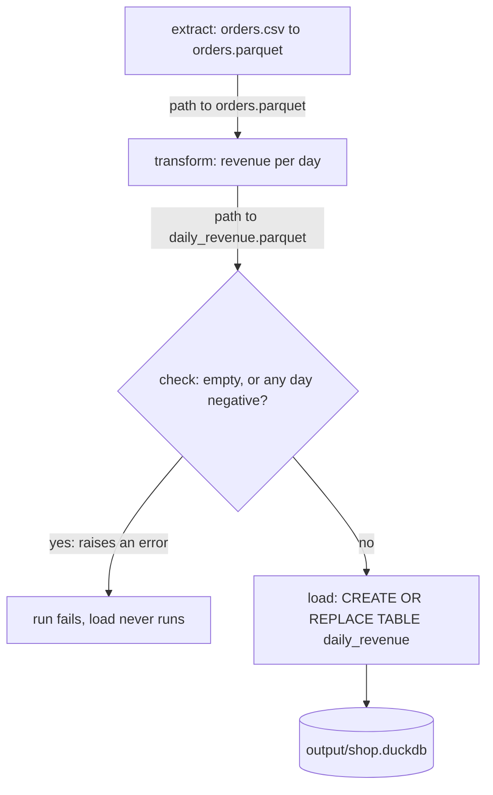

# An Airflow 3 DAG

A small extract, transform, check and load pipeline for the shop's orders, written as an
[Apache Airflow](https://github.com/apache/airflow) 3 DAG with the TaskFlow API (`from airflow.sdk import dag, task`).

Read first: [DAGs in the guide](https://enrichmeai.com/well-rounded-engineer/dags/).

## What it shows

```
extract  ->  transform  ->  check  ->  load
CSV to       revenue        refuse       replace a table
Parquet      per day        bad data     in a DuckDB file
```

- `dags/shop_daily_revenue.py` is the DAG: four tasks and the order they run in, nothing else.
- `dags/shop_etl.py` holds the work as plain Python functions using DuckDB, with no Airflow in them,
  so they can be tested on their own.
- Tasks pass **file paths** to each other, not the data. What a task returns is stored by Airflow as an XCom,
  which is meant for small values.
- `check` raises an error instead of loading an empty or negative result, so a bad run stops before `load`.
- `load` uses `CREATE OR REPLACE`, so running the same day twice gives the same table.
- Three kinds of test in `tests/`:
  - `test_shop_etl.py` tests the functions with plain pytest;
  - `test_dag.py` checks the DAG file loads with no import errors and that its tasks are wired in the right order
    (the pattern from Airflow's best-practices docs);
  - `test_dag_run.py` runs the whole DAG once with `airflow dags test`, against a throwaway SQLite metadata
    database (about 10 seconds).

One run, step by step. Each task hands the next one a file path (a small XCom), never the data itself, and `check` can stop the run before anything is loaded.



## Run it

You need Python 3.11 to 3.14. Airflow asks to be installed against its constraints file, which pins every
dependency to a set it was tested with. Pick the file for your Python version (this one is for 3.13).
From inside this `airflow/` folder:

```bash
python3 -m venv .venv
source .venv/bin/activate          # on Windows: .venv\Scripts\activate (or use WSL)
pip install -r requirements.txt \
  --constraint https://raw.githubusercontent.com/apache/airflow/constraints-3.4.0/constraints-3.13.txt

pytest                             # 8 tests
```

To run the DAG yourself, keep Airflow's files inside this folder and test one run:

```bash
export AIRFLOW_HOME="$PWD/.airflow" AIRFLOW__CORE__DAGS_FOLDER="$PWD/dags" AIRFLOW__CORE__LOAD_EXAMPLES=False
airflow db migrate
airflow dags test shop_daily_revenue 2026-11-14
python -c "import duckdb; duckdb.connect('output/shop.duckdb').sql('SELECT * FROM daily_revenue').show()"
```

To see it in the web UI, run `airflow standalone` with the same variables set, and open the address it prints.

## Try this

1. Add a task between `check` and `load` that writes `daily_revenue` to a CSV file too.
   Update `test_dag.py` so it expects the new task in the right place.
2. Make `check` also fail when any day has more than 100 orders. Add a test for it in `test_shop_etl.py` first.
3. Change `transform` to compute revenue per **customer** per day. Which tests have to change?

## Read next

- [DAGs in the guide](https://enrichmeai.com/well-rounded-engineer/dags/)
- The transformation step done properly, with tests on the data: [`../dbt/`](../dbt/)
