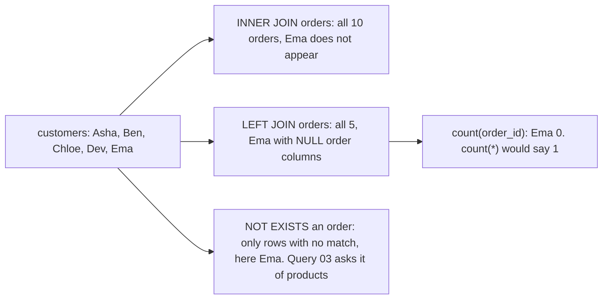
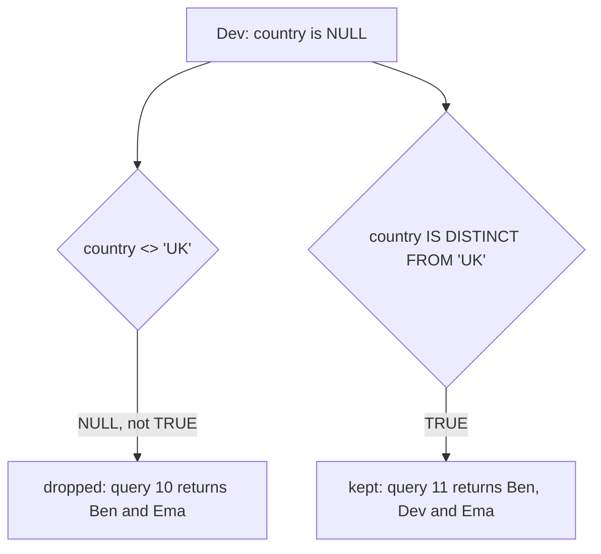

# SQL on DuckDB

Eleven small SQL queries over a tiny online shop: customers, products, orders, and a messy email feed.
They run on [DuckDB](https://github.com/duckdb/duckdb), a database that lives inside your Python process,
so there is no server to install and nothing to sign up for.

Read first: [SQL in the guide](https://enrichmeai.com/well-rounded-engineer/sql/).

## What it shows

| File | Idea |
|---|---|
| `queries/01_inner_join.sql` | INNER JOIN keeps only rows that match on both sides |
| `queries/02_left_join.sql` | LEFT JOIN keeps every customer, even one with no orders; `count(col)` vs `count(*)` |
| `queries/03_anti_join.sql` | NOT EXISTS: products nobody has ordered |
| `queries/04_group_by_having.sql` | WHERE filters rows before grouping, HAVING filters groups after |
| `queries/05_row_number.sql` | ROW_NUMBER: each customer's first order |
| `queries/06_running_total.sql` | A running total with `sum() OVER (... ROWS BETWEEN ...)` |
| `queries/07_lag.sql` | LAG: days since the customer's previous order |
| `queries/08_dedupe_qualify.sql` | QUALIFY: keep the latest row per customer and drop duplicates |
| `queries/09_null_behaviour.sql` | NULL in `count`, `sum`, `avg`, `=`, `IS NOT DISTINCT FROM` and `NOT IN` |
| `queries/10_null_comparison_trap.sql` | `country <> 'UK'` silently drops the customer with no country |
| `queries/11_null_comparison_fix.sql` | `IS DISTINCT FROM` keeps them |

`setup.sql` creates the tables with explicit types and loads them from the CSV files in `data/`.
Every query has a test in `tests/test_queries.py` with the answer worked out by hand from the data.

The three joins on the real data: five customers, ten orders, and Ema has none. Each join answers a different question about the same two tables.



Why query 10 loses Dev. A `WHERE` keeps a row only when its condition is TRUE, and a comparison with NULL is neither TRUE nor FALSE: it is NULL.



## Run it

You need Python 3.11 or newer. From inside this `sql/` folder:

```bash
python3 -m venv .venv
source .venv/bin/activate          # on Windows: .venv\Scripts\activate
pip install -r requirements.txt

python run_query.py queries/07_lag.sql    # print one query's result
pytest                                    # check every query: 11 tests
```

`run_query.py` loads the data into a fresh in-memory database each time, so you cannot break anything.
Edit a query, run it again, and see what changed. If you change what a query returns, its test will fail:
that is the test doing its job.

## Try this

1. In `02_left_join.sql`, change `count(o.order_id)` to `count(*)`. Which customer's number changes, and why?
2. Write a query for each customer's **most recent** order, using QUALIFY instead of a CTE.
3. In `06_running_total.sql`, add a second running total across **all** customers, ordered by date
   (hint: a window with no `PARTITION BY`).
4. Add a test to `tests/test_queries.py` for a query of your own. Work out the answer by hand first.

## Read next

- [SQL in the guide](https://enrichmeai.com/well-rounded-engineer/sql/)
- [Database design in the guide](https://enrichmeai.com/well-rounded-engineer/database/)
- The same shop data, modelled with dbt: [`../dbt/`](../dbt/)
